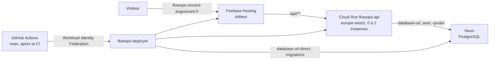

# Déploiement de FlowOps

Production : **https://flowops.vincent-angoulvant.fr**, projet Google Cloud / Firebase `flowops-prod`.



## Déploiement automatique

[`.github/workflows/deploy.yml`](../.github/workflows/deploy.yml) se lance après chaque CI réussie sur `main` (ou à la main depuis l'onglet Actions, sur `main` seulement) :

1. image de l'API construite et poussée dans Artifact Registry, étiquetée par le commit ;
2. migrations Prisma appliquées à Neon (`prisma migrate deploy`, connexion directe) ;
3. nouvelle révision Cloud Run, avec toute sa configuration (variables, secret, limites) ; `/health` doit répondre ;
4. éditeur construit avec la configuration web Firebase (variables GitHub, ci-dessous) et publié sur Firebase Hosting ([`firebase.json`](../firebase.json) : réécriture `/api/**` vers Cloud Run, en-têtes de sécurité, cache).

Aucune clé n'est stockée dans GitHub : le jeton OIDC de GitHub Actions est échangé contre l'identité `flowops-deployer`, et seulement pour la branche `main` de ce dépôt (identifiants numériques du dépôt et du propriétaire, qui ne changent pas si un dépôt du même nom est recréé).

## Configuration du projet Google Cloud (faite une fois)

Région : `europe-west1`. Commandes lancées le 22 octobre 2026, conservées pour pouvoir tout recréer.

```bash
gcloud services enable run.googleapis.com artifactregistry.googleapis.com \
  secretmanager.googleapis.com iamcredentials.googleapis.com sts.googleapis.com

# Images de l'API : seules les 3 plus récentes sont gardées (stockage gratuit)
gcloud artifacts repositories create flowops --repository-format=docker --location=europe-west1
gcloud artifacts repositories set-cleanup-policies flowops --location=europe-west1 \
  --policy=deploy/artifact-cleanup-policy.json --no-dry-run

# Identités
gcloud iam service-accounts create flowops-api        # l'API sur Cloud Run
gcloud iam service-accounts create flowops-deployer   # GitHub Actions

# GitHub sans clé : main de LePo0/FlowOps uniquement
gcloud iam workload-identity-pools create github --location=global
gcloud iam workload-identity-pools providers create-oidc github --location=global \
  --workload-identity-pool=github --issuer-uri=https://token.actions.githubusercontent.com \
  --attribute-mapping="google.subject=assertion.sub,attribute.repository_id=assertion.repository_id,attribute.ref=assertion.ref" \
  --attribute-condition="assertion.repository_id == '1425344739' && assertion.repository_owner_id == '127696207' && assertion.ref == 'refs/heads/main'"
```

Droits, chacun limité à sa cible :

| Qui                | Rôle                                                         | Sur                          | Pour                                                   |
| ------------------ | ------------------------------------------------------------ | ---------------------------- | ------------------------------------------------------ |
| GitHub (`main`)    | `iam.workloadIdentityUser`                                   | `flowops-deployer`           | Prendre cette identité, et aucune autre                |
| `flowops-deployer` | `artifactregistry.writer`                                    | dépôt `flowops`              | Pousser les images                                     |
| `flowops-deployer` | `run.developer`                                              | projet                       | Déployer des révisions (sans changer qui peut appeler) |
| `flowops-deployer` | `iam.serviceAccountUser`                                     | `flowops-api`                | Lancer Cloud Run avec cette identité                   |
| `flowops-deployer` | `secretmanager.secretAccessor`                               | secret `database-url-direct` | Appliquer les migrations                               |
| `flowops-deployer` | `firebasehosting.admin`, `serviceusage.serviceUsageConsumer` | projet                       | Publier l'éditeur                                      |
| `flowops-api`      | `secretmanager.secretAccessor`                               | secret `database-url`        | Se connecter à la base                                 |
| `allUsers`         | `run.invoker`                                                | service `flowops-api`        | Exigé par la réécriture Hosting vers Cloud Run         |

Le service Cloud Run a été créé une première fois avec une image de démonstration de Google, et rendu appelable par `allUsers` : le déployeur n'a donc pas besoin du droit de modifier ces accès.

### Secrets (Secret Manager, stockés en `europe-west1`)

- `database-url` : adresse Neon **avec** `-pooler`, lue par l'API ;
- `database-url-direct` : la même **sans** `-pooler`, pour les migrations.

Saisis par le propriétaire du projet, jamais copiés dans le dépôt ni dans une commande. Nouvelle valeur (mot de passe changé, par exemple) :

```powershell
$file = Join-Path $env:TEMP "secret.txt"
[IO.File]::WriteAllText($file, (Read-Host "Adresse Neon").Trim())
gcloud secrets versions add database-url --data-file=$file
Remove-Item $file
```

puis désactiver l'ancienne version (`gcloud secrets versions disable <n> --secret=database-url`). L'API lit `latest` au démarrage d'une instance.

## Coût

Plafonds de dépenses du projet (console Facturation) : Cloud Run 1 €, Cloud Run Functions 1 €, API Gemini et Agent Platform 0 €. Un plafond atteint coupe le service jusqu'à une relance manuelle. Hors plafond, mais à quelques centimes au plus : Artifact Registry (3 images gardées) et Secret Manager. Neon : offre gratuite.

## Adresse du visiteur (`TRUST_PROXY_HOPS`)

Les limites des sessions de démo comptent les exécutions par adresse IP. Derrière Hosting, la requête traverse au moins deux relais avant l'API : Hosting, puis le répartiteur de Cloud Run, qui voit l'adresse de Hosting (une adresse Google) et non celle du visiteur. `TRUST_PROXY_HOPS` dit à Express combien d'adresses de droite de `X-Forwarded-For` viennent de relais de confiance ; une valeur trop basse ferait partager une seule limite à tous les visiteurs, une valeur trop haute laisserait un client choisir son adresse.

Mesure, à refaire si l'hébergement change :

```bash
# Diagnostic activé sur une nouvelle révision (le prochain déploiement l'enlève)
gcloud run services update flowops-api --region=europe-west1 --update-env-vars=LOG_FORWARDED_FOR=true
# Requêtes passées par Hosting, dont une avec une adresse inventée par le client
curl https://flowops.vincent-angoulvant.fr/api/workflows
curl -H "X-Forwarded-For: 198.51.100.66" https://flowops.vincent-angoulvant.fr/api/workflows
# Lignes « forwarded-for » : en-têtes reçus et adresse retenue
gcloud logging read 'resource.labels.service_name="flowops-api" AND jsonPayload.diagnostic="forwarded-for"' --limit=5 --freshness=10m
gcloud run services update flowops-api --region=europe-west1 --remove-env-vars=LOG_FORWARDED_FOR
```

La bonne valeur est celle pour laquelle `ip` est l'adresse publique du poste qui a lancé `curl`, y compris avec l'en-tête inventé.

**Mesure du 22 octobre 2026** : derrière Hosting, `X-Forwarded-For` vaut `<visiteur>,<adresse Google de Hosting>` (le répartiteur de Cloud Run ajoute la seconde). Hosting **remplace** l'en-tête envoyé par le client : l'adresse inventée n'apparaît pas. D'où `TRUST_PROXY_HOPS=2`.

Risque accepté : l'URL directe du service (`…run.app`) contourne Hosting, et un client qui l'appelle peut y choisir l'adresse vue par l'API, donc contourner la limite **par adresse**. Restent la limite par compte, les exécutions simultanées, la durée maximale, `max-instances=2` et le plafond de dépenses. Fermer l'URL directe (`--no-default-url`) n'est pas possible : la réécriture Hosting en dépend (essai du 22 octobre : `/api` répond alors 404, et Hosting garde ce 404 en cache 10 minutes).

## Clé d'API web

La configuration web de Firebase n'est pas versionnée (aucun `.env` dans le dépôt). Le déploiement la lit dans les **variables** du dépôt GitHub (_Settings > Secrets and variables > Actions > Variables_) :

| Variable               | Valeur                                                    |
| ---------------------- | --------------------------------------------------------- |
| `FIREBASE_WEB_API_KEY` | Clé web de l'application FlowOps du projet `flowops-prod` |
| `FIREBASE_AUTH_DOMAIN` | `flowops-prod.firebaseapp.com`                            |
| `FIREBASE_WEB_APP_ID`  | Identifiant de l'application web (`1:592511140226:web:…`) |

Valeurs dans la console Firebase (_Paramètres du projet > Général > Vos applications_). Ce sont des variables et non des secrets : la clé web identifie le projet et se lit dans le JavaScript du site. Elle est restreinte depuis la console Google Cloud (_API et services > Identifiants_) :

- sites : `https://flowops.vincent-angoulvant.fr/*`, `https://flowops-prod.web.app/*`, `https://flowops-prod.firebaseapp.com/*` (page de connexion de Firebase) ;
- API : `identitytoolkit.googleapis.com` et `securetoken.googleapis.com` (connexion et renouvellement du jeton) seulement.

Vérifié : depuis le site, création d'une session de démo `200` ; depuis un autre site ou sans origine, `403`. La restriction par site se contourne avec un script qui invente l'en-tête `Referer` : elle évite la réutilisation de la clé par un autre site, pas un abus délibéré, que bornent les limites de l'API.
