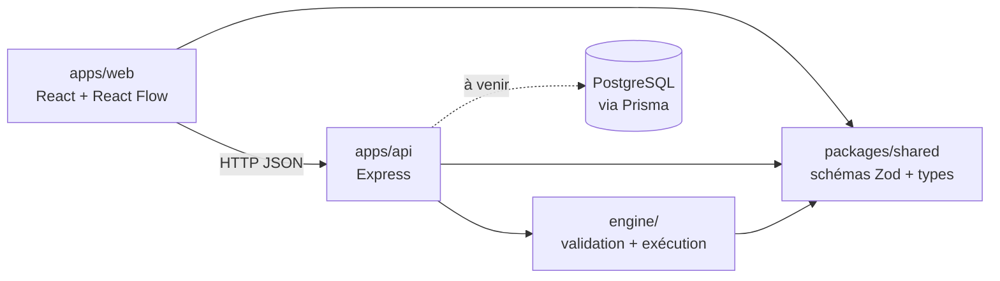
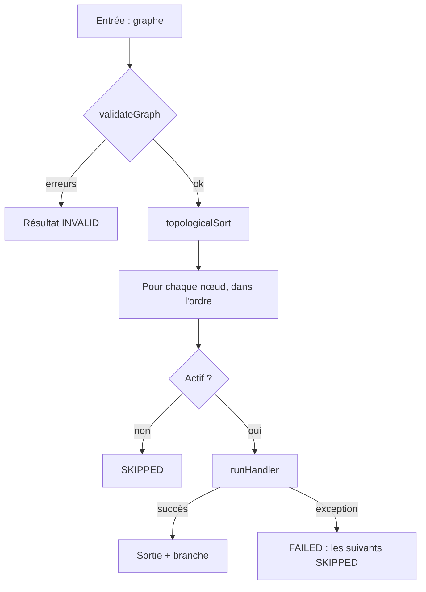
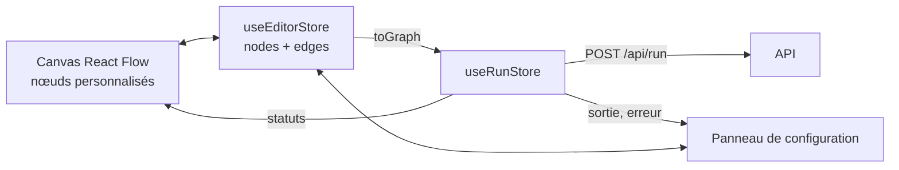

# Architecture de FlowOps

_Document vivant : les parties marquées « à venir » seront complétées au fil du projet._

## 1. Vue d'ensemble

FlowOps est un monolithe modulaire dans un monorepo npm workspaces.



| Module                | Rôle                                                                          |
| --------------------- | ----------------------------------------------------------------------------- |
| `apps/web`            | Éditeur visuel (React Flow), configuration des nœuds, affichage des résultats |
| `apps/api`            | API REST, validation des entrées, orchestration                               |
| `apps/api/src/engine` | Validation du graphe et exécution, en TypeScript pur                          |
| `packages/shared`     | Contrat du workflow : schémas Zod et types partagés front/back                |

## 2. Le contrat du workflow (`packages/shared`)

- Un graphe = `nodes` + `edges`, limité à 50 nœuds et 100 arêtes.
- Quatre types de nœuds en **union discriminée** sur `type` : `trigger`, `http`, `condition`, `transform`. Chacun a son schéma de `config`.
- Une arête peut porter une `branch` (`true` / `false`) : c'est la sortie choisie d'un nœud `condition`.
- Les ids de nœuds suivent `^[A-Za-z0-9_-]{1,64}$` : pas de point, car les références se découpent dessus.
- Le modèle est **indépendant de React Flow**. Le front convertit avec `toGraph()` / `fromGraph()` (voir section 5).

Les références entre nœuds ont la forme `idDuNoeud.chemin.vers.valeur` (ex. `http1.body.products`). Un indice de liste s'écrit comme un champ : `http1.body.results.0.name`.

- Dans la condition (`left`) et la transformation (`source`), le champ entier est une référence.
- Dans le nœud HTTP (URL, valeurs d'en-têtes, corps), les références s'insèrent dans le texte entre accolades : `{{http1.body.results.0.url}}`, `https://api.dev/users/{{transform-1}}`. Une valeur objet ou liste est insérée en JSON, sans encodage d'URL. Une référence vide fait échouer le nœud avec un message explicite.

Le package contient aussi :

- `topologicalSort` (algorithme de Kahn), utilisé par le moteur et par l'éditeur pour détecter les cycles ;
- le contrat de réponse de `POST /api/run` (`RunResultSchema`, `ApiErrorResponseSchema`) : l'API type ses réponses avec, le front les valide à la réception.

## 3. Le moteur (`apps/api/src/engine`)

Aucune dépendance à Express, Prisma ou React Flow.



### Validation en deux niveaux

1. **Forme** : `WorkflowGraphSchema` (Zod).
2. **Structure** (`validate-graph.ts`) : ids uniques, un seul déclencheur, arêtes vers des nœuds existants, aucun arc entrant sur le déclencheur, `branch` cohérente, absence de cycle.

Les erreurs sont **retournées** avec des codes stables (`CYCLE`, `UNKNOWN_NODE`, …), pas lancées.

### Ordre d'exécution

Algorithme de Kahn (`topologicalSort`, dans `packages/shared`), en `O(nœuds + arêtes)`. Il ordonne et détecte les cycles.

### Handlers

Un handler par type de nœud, contrat commun : il reçoit le nœud et un contexte (`outputs`, `fetch`), retourne `{ output, branch? }` et lance une exception en cas d'échec.

- Le `fetch` est **injecté** : les tests n'appellent jamais le réseau.
- Un statut HTTP 4xx/5xx n'est **pas** une erreur du moteur. Le nœud réussit, et c'est la condition qui décide.
- La transformation (`transform.ts`) applique à sa source, dans l'ordre : un **filtre** optionnel sur les éléments d'une liste (mêmes opérateurs et même comparaison stricte que la condition, `compare.ts`), puis **soit** des champs à conserver (chemins imbriqués acceptés, structure gardée : `ability.name` → `{ ability: { name } }`), **soit** un champ à extraire (une valeur par élément : `["overgrow", "chlorophyll"]`). Un champ absent de tous les éléments est une erreur : c'est presque toujours une faute de frappe. Pas de boucle : appeler une URL par élément reste hors périmètre.
- Échecs du nœud HTTP : erreur réseau, timeout, réponse trop grosse, JSON invalide.
- `fetch` ne lève qu'un `fetch failed` générique : `http-errors.ts` lit la `cause` et produit un message clair (certificat non reconnu, domaine introuvable, connexion refusée, délai dépassé, URL invalide…). Ce niveau de détail sert d'oracle pour sonder un réseau interne : à revoir avec la protection SSRF.
- Chaque résultat de nœud peut porter, en plus de `output` et `error` :
  - `input` : ce que le nœud a réellement utilisé. Pour le nœud HTTP, la requête envoyée après résolution des `{{références}}`, avec les en-têtes sensibles (`Authorization`, `Cookie`, `*token*`, `*api-key*`…) masqués ; pour la condition, la valeur testée.
  - `errorDetail` : la chaîne des causes techniques (nom, message, code), sans stack trace.
    Un handler qui échoue lève une `NodeError` pour transmettre `input` au moteur.

### Règle des branches et politique d'échec

- Un nœud s'exécute s'il est le déclencheur, ou si au moins une arête entrante est **active** : sa source a réussi et, si l'arête a une `branch`, c'est celle choisie.
- Sinon il est `SKIPPED`. `SKIPPED` ≠ `FAILED` : l'interface distingue « pas exécuté » de « cassé ».
- Au premier échec, l'exécution s'arrête et les nœuds restants sont `SKIPPED`.

## 4. L'API (`apps/api`)

`createApp({ fetch, nodeEnv? })` construit l'application Express. Le `fetch` est injecté jusqu'au moteur, ce qui permet aux tests Supertest de ne jamais toucher le réseau. `app.ts` exporte aussi un `app` par défaut construit avec le `fetch` global, utilisé par `index.ts`.

Organisation : une route par module (`src/modules/<nom>/` : routeur + schémas), middlewares transverses dans `src/middleware/`.

En développement, `npm run dev:api` lance Node avec `--use-system-ca` : Node fait alors confiance au magasin de certificats du système, en plus des siens. Sans cette option, derrière un proxy d'entreprise qui inspecte le HTTPS, toutes les requêtes du nœud HTTP échouent avec « Certificat TLS non reconnu ».

| Route                                         | Rôle                                                                           |
| --------------------------------------------- | ------------------------------------------------------------------------------ |
| `GET /health`                                 | Sonde de disponibilité : `{ "status": "ok" }`                                  |
| `POST /api/run`                               | Exécute un graphe envoyé dans le corps (**local uniquement**, voir ci-dessous) |
| `/api/workflows`                              | CRUD des workflows de l'utilisateur courant (voir ci-dessous)                  |
| `/api/workflows/:id/runs`, `/api/runs/:runId` | Historique des exécutions d'un workflow enregistré (voir ci-dessous)           |

### `/api/workflows`

| Requête                                    | Réponse                                                                                                      |
| ------------------------------------------ | ------------------------------------------------------------------------------------------------------------ |
| `GET /api/workflows`                       | `200` `{ workflows: [{ id, name, createdAt, updatedAt }] }`, du plus récent au plus ancien, sans les graphes |
| `POST /api/workflows` `{ name, graph }`    | `201` avec le workflow complet et un en-tête `Location`                                                      |
| `GET /api/workflows/:id`                   | `200` `{ id, name, graph, createdAt, updatedAt }`                                                            |
| `PUT /api/workflows/:id` `{ name, graph }` | `200` avec le workflow mis à jour                                                                            |
| `DELETE /api/workflows/:id`                | `204`                                                                                                        |

- Corps validés avec le contrat partagé (`SaveWorkflowRequestSchema`) : `400` `INVALID_BODY` sinon. Le graphe doit être complet (mêmes règles qu'à l'exécution) : un brouillon avec un champ vide ne s'enregistre pas.
- Un identifiant inconnu, mal formé ou appartenant à un autre utilisateur donne le même `404` `NOT_FOUND` : on ne révèle pas l'existence d'un workflow d'autrui.
- Accès aux données via une interface `WorkflowRepository` : implémentation Prisma en production, en mémoire pour les tests de routes.
- En attendant l'authentification, toutes les requêtes appartiennent à un **utilisateur de démonstration** (`demo@flowops.local`), créé au démarrage. Le serveur refuse de démarrer sans `DATABASE_URL`.

### Historique des exécutions

| Requête                                    | Réponse                                                                                                           |
| ------------------------------------------ | ----------------------------------------------------------------------------------------------------------------- |
| `POST /api/workflows/:id/runs` `{ graph }` | Exécute le graphe envoyé et l'enregistre : `201` avec l'exécution complète (`RunDetail`) et un en-tête `Location` |
| `GET /api/workflows/:id/runs`              | `200` `{ runs: [{ id, workflowId, status, startedAt, durationMs }] }`, de la plus récente à la plus ancienne      |
| `GET /api/runs/:runId`                     | `200` avec l'exécution complète : copie du graphe exécuté et résultat de chaque nœud dans l'ordre                 |

- C'est le **graphe affiché dans l'éditeur** qui est exécuté et stocké, même s'il contient des modifications non enregistrées : l'historique montre exactement ce qui a tourné. L'éditeur passe par cette route quand le workflow ouvert est enregistré, et par `POST /api/run` sinon (exécution sans historique).
- La propriété du workflow est vérifiée **avant** l'exécution : aucune URL n'est appelée pour le workflow d'un autre utilisateur. Un graphe invalide donne `400` avec les codes du moteur et n'est pas enregistré.
- Enregistrement en une transaction : `WorkflowRun`, ses `NodeRun`, puis suppression des exécutions au-delà des **50 plus récentes** (`MAX_RUNS_PER_WORKFLOW`) : une sortie de nœud HTTP peut atteindre 1 Mo.
- Comme `/api/run`, la route d'exécution n'est pas montée en production (SSRF) ; la consultation de l'historique reste disponible.

### `POST /api/run`

Corps : `{ "graph": <WorkflowGraph> }`. Zod valide l'enveloppe, puis `executeWorkflow` valide le graphe.

| Cas                                        | Réponse                                                                                  |
| ------------------------------------------ | ---------------------------------------------------------------------------------------- |
| Exécution terminée (`SUCCESS` ou `FAILED`) | `200` `{ status, nodeResults, durationMs }` : un nœud en échec n'est pas une erreur HTTP |
| Enveloppe invalide                         | `400` `{ errors: [{ code: "INVALID_BODY", message }] }`                                  |
| Graphe refusé par le moteur                | `400` `{ errors }` avec les codes du moteur (`CYCLE`, `UNKNOWN_NODE`, …)                 |
| JSON mal formé                             | `400` `{ errors: [{ code: "INVALID_JSON", … }] }`                                        |
| Corps de plus de 1 Mo                      | `413` `{ errors: [{ code: "PAYLOAD_TOO_LARGE", … }] }`                                   |
| Erreur inattendue                          | `500` `{ errors: [{ code: "INTERNAL_ERROR", … }] }`, sans stack trace ni détail interne  |

La route n'est **pas montée** si `NODE_ENV=production` : le nœud HTTP n'est pas encore protégé contre le SSRF (voir la section 6 et l'étape « Sécurité du nœud HTTP » de la roadmap).

## 5. L'éditeur (`apps/web`)

React Flow pour le canvas, Zustand pour l'état. En local, Vite redirige `/api` vers l'API (`localhost:3000`) : le front et l'API partagent la même origine, sans CORS à gérer.



| Module                       | Rôle                                                                                                                                                                                                        |
| ---------------------------- | ----------------------------------------------------------------------------------------------------------------------------------------------------------------------------------------------------------- |
| `editor/graph.ts`            | `fromGraph()` / `toGraph()` : la `branch` d'une arête devient la poignée de sortie (`sourceHandle`) de la condition                                                                                         |
| `editor/store.ts`            | Nœuds et arêtes, callbacks de React Flow, ajout, édition, suppression, sélection                                                                                                                            |
| `editor/connection-rules.ts` | Refuse pendant le tracé ce que le moteur rejetterait : boucle, arête vers le déclencheur, doublon, cycle, branche incohérente                                                                               |
| `editor/nodes/`              | Un composant par type de nœud ; la condition a deux sorties `true` / `false`                                                                                                                                |
| `editor/panel/`              | Formulaire du nœud sélectionné, validé avec le schéma Zod partagé (messages en français)                                                                                                                    |
| `run/`                       | Client de `POST /api/run`, store d'exécution, statuts affichés sur les nœuds et dans le panneau                                                                                                             |
| `workflows/`                 | Document courant : nom, enregistrement (bouton et Ctrl+S), « Ouvrir… » et « Nouveau », état enregistré ou modifié, dernier workflow rouvert au rechargement, confirmation avant de perdre des modifications |

Principes :

- **L'API reste l'autorité.** L'éditeur valide pour donner un retour immédiat (champ manquant, connexion impossible), mais l'API revalide tout le graphe à l'exécution.
- **Un seul déclencheur** : le bouton d'ajout se désactive dès qu'il en existe un.
- **La condition compare en strict** (`===`) : le panneau impose un type explicite (texte, nombre, booléen) pour la valeur attendue, et le nœud affiche un texte entre guillemets.
- Les champs propres à React Flow (`selected`, `measured`, …) ne sortent jamais de l'éditeur : `toGraph()` ne garde que le contrat.

## 6. Limites et sécurité

| Limite                                              | État                                             |
| --------------------------------------------------- | ------------------------------------------------ |
| Nombre de nœuds et d'arêtes                         | En place                                         |
| Taille du corps des requêtes API (1 Mo)             | En place                                         |
| Route `POST /api/run` désactivée en production      | En place, en attendant la protection SSRF        |
| Timeout par requête HTTP (10 s par défaut)          | En place                                         |
| Taille maximale de réponse (vérifiée après lecture) | En place                                         |
| Références sûres (propriétés propres uniquement)    | En place                                         |
| Blocage des adresses locales et privées (SSRF)      | **À venir, prérequis avant toute mise en ligne** |
| Revalidation des redirections                       | À venir                                          |
| Lecture de la réponse en flux avec coupure          | À venir                                          |
| Durée maximale globale d'une exécution              | À venir                                          |
| Secrets (tokens) hors du JSON du graphe et des logs | À venir                                          |

## 7. Persistance

PostgreSQL et Prisma 7 (`apps/api/prisma/schema.prisma`). Prisma 7 se connecte via le pilote `pg` (`@prisma/adapter-pg`) ; le client est généré dans `apps/api/src/generated/prisma` (ignoré par Git, régénéré à chaque `npm install`).

| Table         | Contenu                                                                                                                |
| ------------- | ---------------------------------------------------------------------------------------------------------------------- |
| `User`        | Identité (`email` unique). Présent dès maintenant pour que l'authentification n'impose pas de migrer toutes les tables |
| `Workflow`    | `userId`, `name`, `graphJson` (JSONB, validé avec le schéma Zod partagé avant écriture), dates                         |
| `WorkflowRun` | Statut, début, durée, **copie du graphe exécuté** : l'historique reste cohérent même si le workflow est modifié        |
| `NodeRun`     | Un enregistrement par nœud, dans l'ordre d'exécution : statut, entrée, sortie, erreur, détail technique, durée         |

Suppressions en cascade : un utilisateur emporte ses workflows, un workflow ses exécutions. Un utilisateur ne voit que ses propres workflows et exécutions.

### Base locale

Le poste de développement n'a pas les droits administrateur sur l'instance PostgreSQL installée par le portail d'entreprise. FlowOps utilise donc **sa propre instance**, avec les programmes de cette installation et un dossier de données appartenant à l'utilisateur :

- données dans `%LOCALAPPDATA%\flowops-postgres\data`, **hors de OneDrive** (la synchronisation corromprait la base) ;
- port **5433**, pour ne pas gêner l'instance du portail sur le 5432 ;
- `npm run db:start`, `db:stop`, `db:status` (`scripts/db.mjs`, chemins modifiables avec `PG_BIN` et `PG_DATA`). Ce n'est pas un service Windows : **à relancer après chaque redémarrage du PC**, sinon l'API refuse de démarrer avec « Base de données injoignable » ;
- rôle `flowops` (droit `CREATEDB`, nécessaire à la base temporaire de `prisma migrate dev`), bases `flowops` et `flowops_test` ; URL dans `apps/api/.env`.

Création de l'instance, une seule fois (PowerShell) :

```powershell
$bin = "C:\Program Files\PostgreSQL\18\bin"; $root = "$env:LOCALAPPDATA\flowops-postgres"
New-Item -ItemType Directory -Force $root | Out-Null
# Choisir un mot de passe pour le superutilisateur postgres de cette instance, dans $root\superuser-password.txt
& "$bin\initdb.exe" -D "$root\data" -U postgres --pwfile="$root\superuser-password.txt" --auth=scram-sha-256 -E UTF8 --no-locale
Add-Content "$root\data\postgresql.conf" "port = 5433`nlisten_addresses = 'localhost'"
npm run db:start
# Puis, connecté en postgres sur le port 5433 : CREATE ROLE flowops LOGIN PASSWORD '…' CREATEDB;
# CREATE DATABASE flowops OWNER flowops; CREATE DATABASE flowops_test OWNER flowops;
```

Commandes Prisma (dans `apps/api`) : `npm run db:migrate -w api` crée et applique une migration, `npm run db:generate -w api` régénère le client.

## 8. Qualité et livraison

- Tests : Vitest (+ Supertest pour l'API). Le moteur est testé sans réseau.
- Tests d'intégration de l'API sur une vraie base PostgreSQL (`TEST_DATABASE_URL`) : Vitest y applique les migrations avant de lancer les tests, et ne leur transmet jamais `DATABASE_URL`. Sans base de test, ils sont ignorés en local mais font échouer la CI, où un service `postgres:18` jetable est fourni.
- CI GitLab : `lint`, `typecheck`, `test` en parallèle, sur merge requests et sur `main`.
- Workflow Git : `main` protégé, branches courtes, merge requests avec squash.
- Déploiement cible (à venir) : Docker, Cloud Run, base managée, frontend sur Firebase Hosting.

## 9. Décisions

Les choix détaillés et leurs raisons sont (ou seront) dans `docs/decisions.md`.
