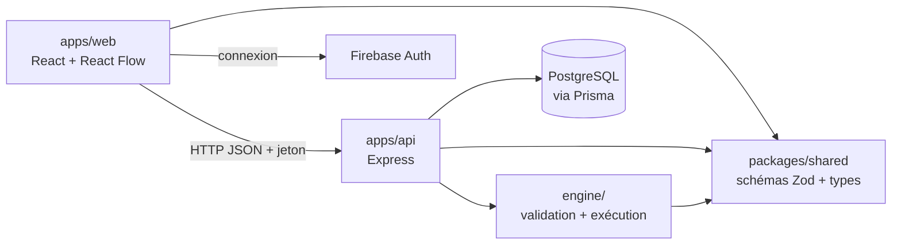
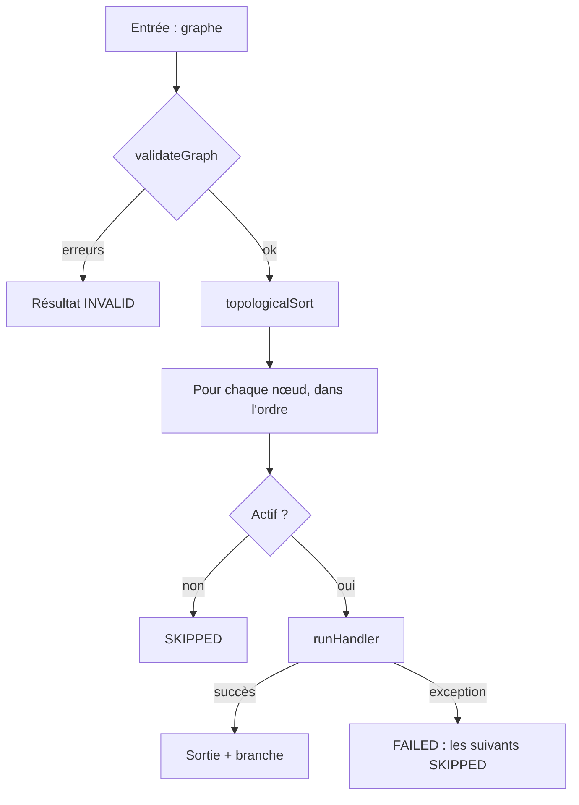
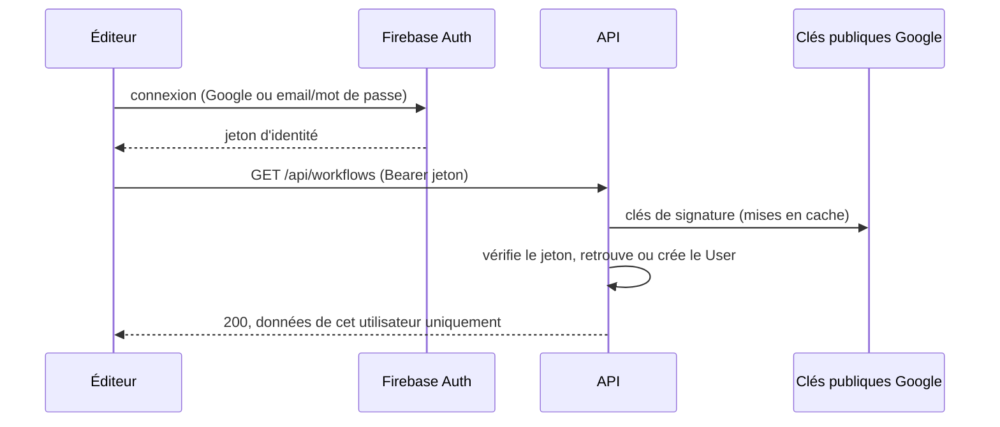
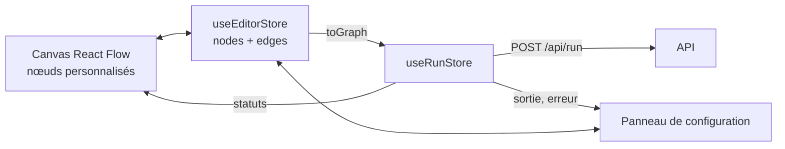

# Architecture de FlowOps

_Document vivant : les parties marquées « à venir » seront complétées au fil du projet._

## 1. Vue d'ensemble

FlowOps est un monolithe modulaire dans un monorepo npm workspaces.



| Module                | Rôle                                                                          |
| --------------------- | ----------------------------------------------------------------------------- |
| `apps/web`            | Éditeur visuel (React Flow), configuration des nœuds, affichage des résultats |
| `apps/api`            | API REST, validation des entrées, orchestration                               |
| `apps/api/src/engine` | Validation du graphe et exécution, en TypeScript pur                          |
| `packages/shared`     | Contrat du workflow : schémas Zod et types partagés front/back                |

## 2. Le contrat du workflow (`packages/shared`)

- Un graphe = `nodes` + `edges`, limité à 50 nœuds et 100 arêtes.
- Quatre types de nœuds en **union discriminée** sur `type` : `trigger`, `http`, `condition`, `transform`. Chacun a son schéma de `config`.
- Une arête peut porter une `branch` (`true` / `false`) : c'est la sortie choisie d'un nœud `condition`.
- Les ids de nœuds suivent `^[A-Za-z0-9_-]{1,64}$` : pas de point, car les références se découpent dessus.
- Le modèle est **indépendant de React Flow**. Le front convertit avec `toGraph()` / `fromGraph()` (voir section 5).

Les références entre nœuds ont la forme `idDuNoeud.chemin.vers.valeur` (ex. `http1.body.products`). Un indice de liste s'écrit comme un champ : `http1.body.results.0.name`.

- Dans la condition (`left`) et la transformation (`source`), le champ entier est une référence.
- Dans le nœud HTTP (URL, valeurs d'en-têtes, corps), les références s'insèrent dans le texte entre accolades : `{{http1.body.results.0.url}}`, `https://api.dev/users/{{transform-1}}`. Une valeur objet ou liste est insérée en JSON, sans encodage d'URL. Une référence vide fait échouer le nœud avec un message explicite.

Le package contient aussi :

- `topologicalSort` (algorithme de Kahn), utilisé par le moteur et par l'éditeur pour détecter les cycles ;
- le contrat de réponse de `POST /api/run` (`RunResultSchema`, `ApiErrorResponseSchema`) : l'API type ses réponses avec, le front les valide à la réception.

## 3. Le moteur (`apps/api/src/engine`)

Aucune dépendance à Express, Prisma ou React Flow.



### Validation en deux niveaux

1. **Forme** : `WorkflowGraphSchema` (Zod).
2. **Structure** (`validate-graph.ts`) : ids uniques, un seul déclencheur, arêtes vers des nœuds existants, aucun arc entrant sur le déclencheur, `branch` cohérente, absence de cycle.

Les erreurs sont **retournées** avec des codes stables (`CYCLE`, `UNKNOWN_NODE`, …), pas lancées.

### Ordre d'exécution

Algorithme de Kahn (`topologicalSort`, dans `packages/shared`), en `O(nœuds + arêtes)`. Il ordonne et détecte les cycles.

### Handlers

Un handler par type de nœud, contrat commun : il reçoit le nœud et un contexte (`outputs`, `fetch`), retourne `{ output, branch? }` et lance une exception en cas d'échec.

- Le `fetch` est **injecté** : les tests n'appellent jamais le réseau.
- Un statut HTTP 4xx/5xx n'est **pas** une erreur du moteur. Le nœud réussit, et c'est la condition qui décide.
- La transformation (`transform.ts`) applique à sa source, dans l'ordre : un **filtre** optionnel sur les éléments d'une liste (mêmes opérateurs et même comparaison stricte que la condition, `compare.ts`), puis **soit** des champs à conserver (chemins imbriqués acceptés, structure gardée : `ability.name` → `{ ability: { name } }`), **soit** un champ à extraire (une valeur par élément : `["overgrow", "chlorophyll"]`). Un champ absent de tous les éléments est une erreur : c'est presque toujours une faute de frappe. Pas de boucle : appeler une URL par élément reste hors périmètre.
- Échecs du nœud HTTP : cible non autorisée, erreur réseau, timeout, échéance globale, réponse trop grosse, JSON invalide.
- `fetch` ne lève qu'un `fetch failed` générique : `http-errors.ts` lit la `cause` et produit un message clair (certificat non reconnu, domaine introuvable, connexion refusée, délai dépassé, URL invalide…). Ces détails ne concernent que des cibles autorisées : une cible refusée donne toujours « Adresse non autorisée », sans cause.
- En production, le `fetch` injecté est le **fetch gardé** (`engine/network/`) : politique réseau vérifiée sur chaque adresse résolue, connexion épinglée sur l'adresse vérifiée, redirections suivies et revérifiées par FlowOps. Le corps est lu en flux et coupé au-delà de 1 Mo ; une échéance globale (60 s) borne toute l'exécution. Détails et scénarios : [`docs/security/http-node.md`](security/http-node.md).
- Chaque résultat de nœud peut porter, en plus de `output` et `error` :
  - `input` : ce que le nœud a réellement utilisé. Pour le nœud HTTP, la requête envoyée après résolution des `{{références}}`, avec les en-têtes sensibles (`Authorization`, `Cookie`, `*token*`, `*api-key*`…) masqués ; pour la condition, la valeur testée.
  - `errorDetail` : la chaîne des causes techniques (nom, message, code), sans stack trace.
    Un handler qui échoue lève une `NodeError` pour transmettre `input` au moteur.

### Règle des branches et politique d'échec

- Un nœud s'exécute s'il est le déclencheur, ou si au moins une arête entrante est **active** : sa source a réussi et, si l'arête a une `branch`, c'est celle choisie.
- Sinon il est `SKIPPED`. `SKIPPED` ≠ `FAILED` : l'interface distingue « pas exécuté » de « cassé ».
- Au premier échec, l'exécution s'arrête et les nœuds restants sont `SKIPPED`.

## 4. L'API (`apps/api`)

`createApp({ fetch, auth, workflows?, runs?, nodeEnv? })` construit l'application Express ; `index.ts` lui passe les implémentations réelles (Prisma, vérificateur Firebase). Le `fetch` est injecté jusqu'au moteur, ce qui permet aux tests Supertest de ne jamais toucher le réseau.

Organisation : une route par module (`src/modules/<nom>/` : routeur + schémas), middlewares transverses dans `src/middleware/`.

En développement, `npm run dev:api` lance Node avec `--use-system-ca` : Node fait alors confiance au magasin de certificats du système, en plus des siens. Sans cette option, derrière un proxy d'entreprise qui inspecte le HTTPS, toutes les requêtes du nœud HTTP échouent avec « Certificat TLS non reconnu ».

| Route                                         | Rôle                                                                      |
| --------------------------------------------- | ------------------------------------------------------------------------- |
| `GET /health`                                 | Sonde de disponibilité : `{ "status": "ok" }` (seule route publique)      |
| `POST /api/run`                               | Exécute un graphe envoyé dans le corps, sans historique (voir ci-dessous) |
| `/api/workflows`                              | CRUD des workflows de l'utilisateur courant (voir ci-dessous)             |
| `/api/workflows/:id/runs`, `/api/runs/:runId` | Historique des exécutions d'un workflow enregistré (voir ci-dessous)      |

### Authentification

Les comptes sont gérés par **Firebase Authentication** (Google et email/mot de passe). FlowOps ne stocke aucun mot de passe : l'éditeur obtient un **jeton d'identité** (JWT signé par Google, valable une heure, renouvelé par le SDK) et l'envoie sur chaque appel (`Authorization: Bearer <jeton>`). Pas de cookie, donc pas de CSRF.



Le middleware `authenticate()` (`src/auth/`) protège toutes les routes `/api`, `/api/run` compris ; seul `/health` est public. Il passe **avant** la lecture du corps JSON : une requête anonyme est refusée sans être analysée.

| Cas                                                     | Réponse                                                                               |
| ------------------------------------------------------- | ------------------------------------------------------------------------------------- |
| En-tête absent, autre schéma que `Bearer`, jeton refusé | `401` `UNAUTHENTICATED`                                                               |
| Jeton valide mais adresse email non vérifiée            | `403` `EMAIL_NOT_VERIFIED` (sinon, on pourrait ouvrir un compte à l'adresse d'autrui) |
| Jeton anonyme avec `DEMO_SESSIONS_ENABLED=false`        | `403` `DEMO_SESSIONS_DISABLED`                                                        |
| Clés publiques injoignables (réseau, proxy)             | `500` journalisé : une panne n'est pas confondue avec un jeton invalide               |
| Ressource d'un autre utilisateur                        | `404`, comme une ressource inexistante                                                |

- **Vérification du jeton** (`firebase-token-verifier.ts`) avec `jose`, selon la méthode documentée par Firebase pour les bibliothèques JWT tierces : signature RS256 par les clés publiques de Google, `aud` = projet, `iss` = `https://securetoken.google.com/<projet>`, `exp` futur, `iat` et `auth_time` passés, `sub` non vide. `firebase-admin` n'est pas utilisé : il renvoie la même erreur pour un jeton falsifié et pour un échec de téléchargement des clés.
- **Identité** : l'utilisateur est retrouvé par l'uid Firebase (`User.authUid`) et créé à sa première requête (`prisma-user-directory.ts`, sans écriture tant que l'email et le nom ne changent pas). L'email n'est pas une clé : il peut changer, et deux comptes Firebase peuvent le partager.
- **Tests** : `createApp` reçoit `auth: { verifyToken, users }`. Les tests de routes utilisent un double (`test-support/fake-auth.ts` : le jeton est l'identifiant de l'utilisateur) mais passent par le vrai middleware. Le vérificateur est testé avec des jetons signés par une clé locale, sans réseau.
- **Émulateur Firebase Auth** (tests de bout en bout) : ses jetons ne sont pas signés (`alg: none`). Avec `FIREBASE_AUTH_EMULATOR_HOST`, l'API les vérifie avec `createEmulatorTokenVerifier` : mêmes contrôles de claims, sans la signature. `config/server-config.ts` refuse de démarrer dans ce mode en production, ou si `FIREBASE_PROJECT_ID` n'est pas un projet `demo-*` (réservé à l'émulateur par Firebase) : une variable oubliée ne peut pas ouvrir l'API à des jetons fabriqués. L'éditeur se connecte à l'émulateur avec `VITE_FIREBASE_AUTH_EMULATOR_HOST`.
- **CORS** limité à `CORS_ORIGIN` (l'éditeur).
- Le serveur refuse de démarrer sans `DATABASE_URL` ni `FIREBASE_PROJECT_ID`. Deux projets Firebase séparés : `-dev` pour le local, `-prod` pour la mise en ligne.

#### Sessions de démo

Pour que FlowOps soit testable sans compte, chaque visiteur reçoit une **session de démo** : un compte anonyme Firebase, propre à son navigateur. Pour l'API, c'est un utilisateur comme un autre (même middleware, même isolation), avec ces différences :

- le jeton anonyme (`firebase.sign_in_provider` = `anonymous`) est accepté sans email ; `DEMO_SESSIONS_ENABLED=false` le refuse (`403` `DEMO_SESSIONS_DISABLED`) sans toucher aux comptes vérifiés ;
- à la création du `User` (`isAnonymous`, sans email), trois workflows d'exemple sont créés dans la même écriture (`src/demo/examples.ts`) ;
- des quotas plus stricts (`src/usage/plans.ts`) : exécutions par minute (par compte et par adresse IP), exécutions simultanées, durée, taille des réponses, workflows enregistrés, historique conservé ;
- `User.lastSeenAt` est mis à jour à l'heure près ; l'API supprime les sessions inactives depuis 7 jours, au démarrage puis toutes les heures (`src/demo/cleanup.ts`).

Le visiteur peut transformer sa session en vrai compte (même uid Firebase) : le `User` perd `isAnonymous`, garde ses workflows et passe aux limites d'un compte vérifié. Côté éditeur, voir la section 5. Règles, seuils et options écartées (compte de démo partagé, mode invité sans enregistrement) : [`docs/security/demo-sessions.md`](security/demo-sessions.md).

#### Limites d'exécution

`POST /api/run` et `POST /api/workflows/:id/runs` passent par `createRunLimits()` (`src/usage/run-limits.ts`) avant toute lecture du graphe : au-delà, `429` `RATE_LIMITED` avec `Retry-After`, sans appeler d'URL. Les compteurs sont en mémoire, par instance : limite approximative, acceptée avec peu d'instances Cloud Run. L'adresse IP est `req.ip`, qui tient compte de `TRUST_PROXY_HOPS` (2 en production, derrière Firebase Hosting puis le répartiteur de Cloud Run : mesure dans `deploy/README.md`) ; en IPv6, la limite porte sur le /64. Toutes les réponses `/api` portent `Cache-Control: no-store` : un cache partagé (CDN de Hosting, proxy) ne peut pas servir les données d'un compte à un autre.

### `/api/workflows`

| Requête                                    | Réponse                                                                                                      |
| ------------------------------------------ | ------------------------------------------------------------------------------------------------------------ |
| `GET /api/workflows`                       | `200` `{ workflows: [{ id, name, createdAt, updatedAt }] }`, du plus récent au plus ancien, sans les graphes |
| `POST /api/workflows` `{ name, graph }`    | `201` avec le workflow complet et un en-tête `Location`                                                      |
| `GET /api/workflows/:id`                   | `200` `{ id, name, graph, createdAt, updatedAt }`                                                            |
| `PUT /api/workflows/:id` `{ name, graph }` | `200` avec le workflow mis à jour                                                                            |
| `DELETE /api/workflows/:id`                | `204`                                                                                                        |

- Corps validés avec le contrat partagé (`SaveWorkflowRequestSchema`) : `400` `INVALID_BODY` sinon. Le graphe doit être complet (mêmes règles qu'à l'exécution) : un brouillon avec un champ vide ne s'enregistre pas.
- Un identifiant inconnu, mal formé ou appartenant à un autre utilisateur donne le même `404` `NOT_FOUND` : on ne révèle pas l'existence d'un workflow d'autrui.
- Une session de démo garde au plus 5 workflows : au-delà, `403` `QUOTA_EXCEEDED`.
- Accès aux données via une interface `WorkflowRepository` : implémentation Prisma en production, en mémoire pour les tests de routes.

### Historique des exécutions

| Requête                                    | Réponse                                                                                                           |
| ------------------------------------------ | ----------------------------------------------------------------------------------------------------------------- |
| `POST /api/workflows/:id/runs` `{ graph }` | Exécute le graphe envoyé et l'enregistre : `201` avec l'exécution complète (`RunDetail`) et un en-tête `Location` |
| `GET /api/workflows/:id/runs`              | `200` `{ runs: [{ id, workflowId, status, startedAt, durationMs }] }`, de la plus récente à la plus ancienne      |
| `GET /api/runs/:runId`                     | `200` avec l'exécution complète : copie du graphe exécuté et résultat de chaque nœud dans l'ordre                 |

- C'est le **graphe affiché dans l'éditeur** qui est exécuté et stocké, même s'il contient des modifications non enregistrées : l'historique montre exactement ce qui a tourné. L'éditeur passe par cette route quand le workflow ouvert est enregistré, et par `POST /api/run` sinon (exécution sans historique).
- La propriété du workflow est vérifiée **avant** l'exécution : aucune URL n'est appelée pour le workflow d'un autre utilisateur. Un graphe invalide donne `400` avec les codes du moteur et n'est pas enregistré.
- Enregistrement en une transaction : `WorkflowRun`, ses `NodeRun`, puis suppression des exécutions au-delà des **50 plus récentes** (`MAX_RUNS_PER_WORKFLOW`, 10 pour une session de démo) : une sortie de nœud HTTP peut atteindre 1 Mo.
- Session de démo : l'historique garde au plus 500 Ko de résultats par exécution. Au-delà, l'entrée et la sortie des nœuds suivants sont remplacées par un message ; la réponse de la route, elle, reste complète.

### `POST /api/run`

Corps : `{ "graph": <WorkflowGraph> }`. Zod valide l'enveloppe, puis `executeWorkflow` valide le graphe.

| Cas                                        | Réponse                                                                                  |
| ------------------------------------------ | ---------------------------------------------------------------------------------------- |
| Exécution terminée (`SUCCESS` ou `FAILED`) | `200` `{ status, nodeResults, durationMs }` : un nœud en échec n'est pas une erreur HTTP |
| Enveloppe invalide                         | `400` `{ errors: [{ code: "INVALID_BODY", message }] }`                                  |
| Graphe refusé par le moteur                | `400` `{ errors }` avec les codes du moteur (`CYCLE`, `UNKNOWN_NODE`, …)                 |
| JSON mal formé                             | `400` `{ errors: [{ code: "INVALID_JSON", … }] }`                                        |
| Corps de plus de 1 Mo                      | `413` `{ errors: [{ code: "PAYLOAD_TOO_LARGE", … }] }`                                   |
| Erreur inattendue                          | `500` `{ errors: [{ code: "INTERNAL_ERROR", … }] }`, sans stack trace ni détail interne  |

Comme toutes les exécutions, elle passe par le fetch gardé du nœud HTTP (politique réseau, voir la section 6).

## 5. L'éditeur (`apps/web`)

React Flow pour le canvas, Zustand pour l'état. En local, Vite redirige `/api` vers l'API (`localhost:3000`) : le front et l'API partagent la même origine, sans CORS à gérer.



| Module                       | Rôle                                                                                                                                                                                                                                                                                                                                                                                                                      |
| ---------------------------- | ------------------------------------------------------------------------------------------------------------------------------------------------------------------------------------------------------------------------------------------------------------------------------------------------------------------------------------------------------------------------------------------------------------------------- |
| `auth/`                      | Session de démo ouverte sans clic, connexion Firebase (Google, email/mot de passe, inscription, mot de passe oublié, vérification de l'email), passage d'une session de démo à un vrai compte, `authFetch` qui ajoute le jeton à chaque appel et signale un `401` ou le refus des sessions de démo, menu utilisateur et bandeau de démo. Firebase est derrière une interface `AuthClient` : le store se teste sans réseau |
| `editor/graph.ts`            | `fromGraph()` / `toGraph()` : la `branch` d'une arête devient la poignée de sortie (`sourceHandle`) de la condition                                                                                                                                                                                                                                                                                                       |
| `editor/store.ts`            | Nœuds et arêtes, callbacks de React Flow, ajout, édition, suppression, sélection                                                                                                                                                                                                                                                                                                                                          |
| `editor/connection-rules.ts` | Refuse pendant le tracé ce que le moteur rejetterait : boucle, arête vers le déclencheur, doublon, cycle, branche incohérente                                                                                                                                                                                                                                                                                             |
| `editor/nodes/`              | Un composant par type de nœud ; la condition a deux sorties `true` / `false`                                                                                                                                                                                                                                                                                                                                              |
| `editor/panel/`              | Formulaire du nœud sélectionné, validé avec le schéma Zod partagé (messages en français)                                                                                                                                                                                                                                                                                                                                  |
| `history/`                   | Fenêtre « Historique » d'un workflow enregistré : liste des exécutions, détail par nœud (noms tirés de la copie du graphe exécuté, le workflow a pu changer depuis), relance de cette copie via `POST /api/workflows/:id/runs`                                                                                                                                                                                            |
| `run/`                       | Client de `POST /api/run`, store d'exécution, statuts affichés sur les nœuds et dans le panneau                                                                                                                                                                                                                                                                                                                           |
| `workflows/`                 | Document courant : nom, enregistrement (bouton et Ctrl+S), « Ouvrir… » et « Nouveau », état enregistré ou modifié, dernier workflow rouvert au rechargement, confirmation avant de perdre des modifications                                                                                                                                                                                                               |

Principes :

- **L'API reste l'autorité.** L'éditeur valide pour donner un retour immédiat (champ manquant, connexion impossible), mais l'API revalide tout le graphe à l'exécution.
- **Une session de démo d'abord** : sans compte, l'éditeur ouvre une session de démo (compte anonyme Firebase) et son premier exemple. La connexion et la création de compte s'ouvrent dans une fenêtre par-dessus l'éditeur : revenir à la démo ne perd pas le workflow en cours. Créer un compte (Google ou email) **lie** la session : même uid, mêmes workflows. Se connecter à un compte existant quitte la session de démo, ce que la fenêtre annonce. Si Firebase ou l'API refuse les sessions de démo (`DEMO_SESSIONS_DISABLED`), seul l'écran de connexion reste.
- **Rien d'un compte ne survit à un changement de compte** (déconnexion, session de démo quittée) : l'éditeur repart du graphe de départ et le « dernier workflow ouvert » est oublié ; un chargement commencé pour le compte précédent est ignoré. Après une déconnexion, une nouvelle session de démo s'ouvre.
- **Un seul déclencheur** : le bouton d'ajout se désactive dès qu'il en existe un.
- **La condition compare en strict** (`===`) : le panneau impose un type explicite (texte, nombre, booléen) pour la valeur attendue, et le nœud affiche un texte entre guillemets.
- Les champs propres à React Flow (`selected`, `measured`, …) ne sortent jamais de l'éditeur : `toGraph()` ne garde que le contrat.

## 6. Limites et sécurité

| Limite                                              | État                                             |
| --------------------------------------------------- | ------------------------------------------------ |
| Nombre de nœuds et d'arêtes                         | En place                                         |
| Taille du corps des requêtes API (1 Mo)             | En place                                         |
| Limite d'exécutions (par compte, par IP en démo)    | En place (`src/usage/`)                          |
| Quotas et nettoyage des sessions de démo            | En place (`docs/security/demo-sessions.md`)      |
| Timeout par requête HTTP (10 s par défaut)          | En place                                         |
| Taille maximale de réponse (1 Mo, lue en flux)      | En place                                         |
| Références sûres (propriétés propres uniquement)    | En place                                         |
| Authentification sur toutes les routes `/api`       | En place (Firebase, email vérifié obligatoire)   |
| CORS limité à l'origine de l'éditeur                | En place                                         |
| Politique réseau des cibles (SSRF)                  | En place (défaut : adresses publiques seules)    |
| Revalidation des redirections                       | En place (5 au maximum)                          |
| Durée maximale globale d'une exécution              | En place (60 s)                                  |
| Secrets (tokens) hors du JSON du graphe et des logs | Hors MVP (piste d'évolution : coffre de secrets) |

FlowOps doit pouvoir tourner en SaaS public comme sur le réseau d'une entreprise, pour appeler ses API internes. Le nœud HTTP ne bloque donc pas « toutes les adresses privées » : il applique une **politique réseau fixée par l'administrateur du déploiement**. Par défaut, seules les adresses publiques sont autorisées. Des réseaux et domaines internes s'ouvrent par variable d'environnement, et certaines cibles restent toujours interdites (boucle locale, serveur de métadonnées du cloud). Règles, modes et scénarios vérifiés : [`docs/security/http-node.md`](security/http-node.md).

## 7. Persistance

PostgreSQL et Prisma 7 (`apps/api/prisma/schema.prisma`). Prisma 7 se connecte via le pilote `pg` (`@prisma/adapter-pg`) ; le client est généré dans `apps/api/src/generated/prisma` (ignoré par Git, régénéré à chaque `npm install`).

| Table         | Contenu                                                                                                                                          |
| ------------- | ------------------------------------------------------------------------------------------------------------------------------------------------ |
| `User`        | Compte Firebase : `authUid` (unique, clé d'identité), `email` (absent en démo), `name`, `isAnonymous`, `lastSeenAt` ; créé à la première requête |
| `Workflow`    | `userId`, `name`, `graphJson` (JSONB, validé avec le schéma Zod partagé avant écriture), dates                                                   |
| `WorkflowRun` | Statut, début, durée, **copie du graphe exécuté** : l'historique reste cohérent même si le workflow est modifié                                  |
| `NodeRun`     | Un enregistrement par nœud, dans l'ordre d'exécution : statut, entrée, sortie, erreur, détail technique, durée                                   |

Suppressions en cascade : un utilisateur emporte ses workflows, un workflow ses exécutions. Un utilisateur ne voit que ses propres workflows et exécutions.

### Base locale

N'importe quel PostgreSQL 18 sur le port 5432, avec un rôle `flowops` (droit `CREATEDB`, nécessaire à la base temporaire de `prisma migrate dev`) et deux bases, `flowops` et `flowops_test`. URL dans `apps/api/.env`.

- **Avec Docker** : `docker compose up -d` lance PostgreSQL 18 avec ce rôle et ces deux bases (identifiants de `apps/api/.env.example`), comme le service jetable de la CI. Données dans un volume Docker.
- **PostgreSQL installé sur le poste** (service Windows, démarré avec le système) : créer le rôle et les bases une fois, connecté en superutilisateur :

```sql
CREATE ROLE flowops LOGIN PASSWORD '…' CREATEDB;
CREATE DATABASE flowops OWNER flowops;
CREATE DATABASE flowops_test OWNER flowops;
```

Commandes Prisma (dans `apps/api`) : `npm run db:migrate -w api` crée et applique une migration, `npm run db:generate -w api` régénère le client.

## 8. Qualité et livraison

- Tests : Vitest (+ Supertest pour l'API). Le moteur est testé sans réseau.
- Tests d'intégration de l'API sur une vraie base PostgreSQL (`TEST_DATABASE_URL`) : Vitest y applique les migrations avant de lancer les tests, et ne leur transmet jamais `DATABASE_URL`. Sans base de test, ils sont ignorés en local mais font échouer la CI, où un service `postgres:18` jetable est fourni.
- Tests de bout en bout (`e2e/`) : Playwright pilote l'éditeur dans Chromium contre la vraie API, une base dédiée (`flowops_e2e`) et l'émulateur Firebase Auth. Un service cible local remplace Internet pour le nœud HTTP : il écoute sur une adresse privée de la machine, ouverte par `HTTP_ALLOWED_TARGETS`, puisque la boucle locale reste toujours refusée. Scénarios : inscription et vérification de l'adresse, déconnexion et isolation, exécution nominale, cible refusée, réponse 404, modification puis relance depuis l'historique.
- CI GitHub Actions : `lint`, `typecheck`, `test`, `format` et `e2e` en parallèle, sur pull requests et sur `main`.
- Workflow Git : `main` protégé, branches courtes, pull requests avec squash.
- Déploiement cible (à venir, étape 9 de la roadmap) : `flowops.vincent-angoulvant.fr` sur Firebase Hosting, qui réécrit `/api/**` vers l'API sur Cloud Run ; base PostgreSQL Neon (offre gratuite) ; la même image Docker, configurée par variables d'environnement, pour une installation en entreprise.

## 9. Décisions

Les choix structurants, leurs raisons et ce qui a été écarté : [`docs/decisions.md`](decisions.md).
