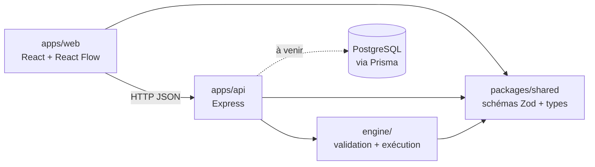
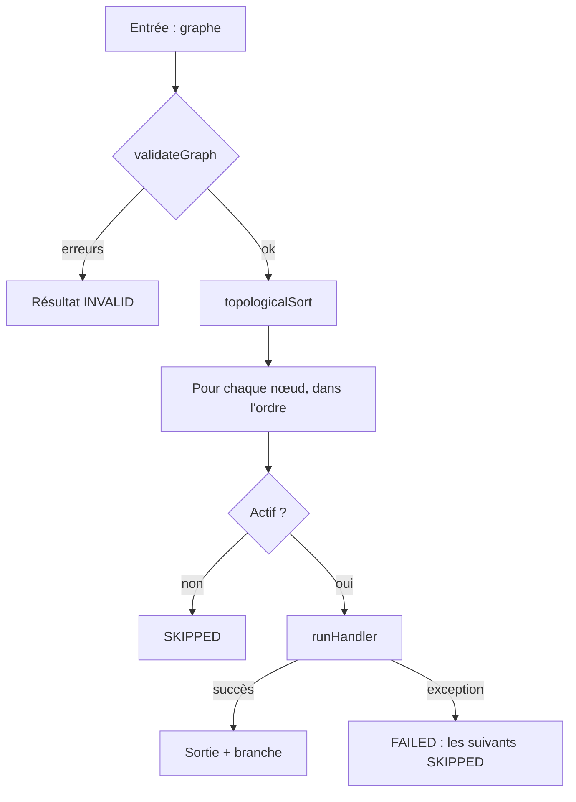

# Architecture de FlowOps

_Document vivant : les parties marquées « à venir » seront complétées au fil du projet._

## 1. Vue d'ensemble

FlowOps est un monolithe modulaire dans un monorepo npm workspaces.

| Module                | Rôle                                                                          |
| --------------------- | ----------------------------------------------------------------------------- |
| `apps/web`            | Éditeur visuel (React Flow), configuration des nœuds, affichage des résultats |
| `apps/api`            | API REST, validation des entrées, orchestration                               |
| `apps/api/src/engine` | Validation du graphe et exécution, en TypeScript pur                          |
| `packages/shared`     | Contrat du workflow : schémas Zod et types partagés front/back                |

## 2. Le contrat du workflow (`packages/shared`)

- Un graphe = `nodes` + `edges`, limité à 50 nœuds et 100 arêtes.
- Quatre types de nœuds en **union discriminée** sur `type` : `trigger`, `http`, `condition`, `transform`. Chacun a son schéma de `config`.
- Une arête peut porter une `branch` (`true` / `false`) : c'est la sortie choisie d'un nœud `condition`.
- Les ids de nœuds suivent `^[A-Za-z0-9_-]{1,64}$` : pas de point, car les références se découpent dessus.
- Le modèle est **indépendant de React Flow**. Le front convertira (`toGraph()` / `fromGraph()`).

Les références entre nœuds ont la forme `idDuNoeud.chemin.vers.valeur` (ex. `http1.body.products`).

## 3. Le moteur (`apps/api/src/engine`)

Aucune dépendance à Express, Prisma ou React Flow.

### Validation en deux niveaux

1. **Forme** : `WorkflowGraphSchema` (Zod).
2. **Structure** (`validate-graph.ts`) : ids uniques, un seul déclencheur, arêtes vers des nœuds existants, aucun arc entrant sur le déclencheur, `branch` cohérente, absence de cycle.

Les erreurs sont **retournées** avec des codes stables (`CYCLE`, `UNKNOWN_NODE`, …), pas lancées.

### Ordre d'exécution

Algorithme de Kahn (`topological-sort.ts`), en `O(nœuds + arêtes)`. Il ordonne et détecte les cycles.

### Handlers

Un handler par type de nœud, contrat commun : il reçoit le nœud et un contexte (`outputs`, `fetch`), retourne `{ output, branch? }` et lance une exception en cas d'échec.

- Le `fetch` est **injecté** : les tests n'appellent jamais le réseau.
- Un statut HTTP 4xx/5xx n'est **pas** une erreur du moteur. Le nœud réussit, et c'est la condition qui décide.
- Échecs du nœud HTTP : erreur réseau, timeout, réponse trop grosse, JSON invalide.

### Règle des branches et politique d'échec

- Un nœud s'exécute s'il est le déclencheur, ou si au moins une arête entrante est **active** : sa source a réussi et, si l'arête a une `branch`, c'est celle choisie.
- Sinon il est `SKIPPED`. `SKIPPED` ≠ `FAILED` : l'interface distingue « pas exécuté » de « cassé ».
- Au premier échec, l'exécution s'arrête et les nœuds restants sont `SKIPPED`.

## 4. L'API (`apps/api`)

`createApp({ fetch, nodeEnv? })` construit l'application Express. Le `fetch` est injecté jusqu'au moteur, ce qui permet aux tests Supertest de ne jamais toucher le réseau. `app.ts` exporte aussi un `app` par défaut construit avec le `fetch` global, utilisé par `index.ts`.

Organisation : une route par module (`src/modules/<nom>/` : routeur + schémas), middlewares transverses dans `src/middleware/`.

| Route           | Rôle                                                                           |
| --------------- | ------------------------------------------------------------------------------ |
| `GET /health`   | Sonde de disponibilité : `{ "status": "ok" }`                                  |
| `POST /api/run` | Exécute un graphe envoyé dans le corps (**local uniquement**, voir ci-dessous) |

### `POST /api/run`

Corps : `{ "graph": <WorkflowGraph> }`. Zod valide l'enveloppe, puis `executeWorkflow` valide le graphe.

| Cas                                        | Réponse                                                                                  |
| ------------------------------------------ | ---------------------------------------------------------------------------------------- |
| Exécution terminée (`SUCCESS` ou `FAILED`) | `200` `{ status, nodeResults, durationMs }` : un nœud en échec n'est pas une erreur HTTP |
| Enveloppe invalide                         | `400` `{ errors: [{ code: "INVALID_BODY", message }] }`                                  |
| Graphe refusé par le moteur                | `400` `{ errors }` avec les codes du moteur (`CYCLE`, `UNKNOWN_NODE`, …)                 |
| JSON mal formé                             | `400` `{ errors: [{ code: "INVALID_JSON", … }] }`                                        |
| Corps de plus de 1 Mo                      | `413` `{ errors: [{ code: "PAYLOAD_TOO_LARGE", … }] }`                                   |
| Erreur inattendue                          | `500` `{ errors: [{ code: "INTERNAL_ERROR", … }] }`, sans stack trace ni détail interne  |

La route n'est **pas montée** si `NODE_ENV=production` : le nœud HTTP n'est pas encore protégé contre le SSRF (voir la section 5 et l'étape « Sécurité du nœud HTTP » de la roadmap).

## 5. Limites et sécurité

| Limite                                              | État                                             |
| --------------------------------------------------- | ------------------------------------------------ |
| Nombre de nœuds et d'arêtes                         | En place                                         |
| Taille du corps des requêtes API (1 Mo)             | En place                                         |
| Route `POST /api/run` désactivée en production      | En place, en attendant la protection SSRF        |
| Timeout par requête HTTP (10 s par défaut)          | En place                                         |
| Taille maximale de réponse (vérifiée après lecture) | En place                                         |
| Références sûres (propriétés propres uniquement)    | En place                                         |
| Blocage des adresses locales et privées (SSRF)      | **À venir, prérequis avant toute mise en ligne** |
| Revalidation des redirections                       | À venir                                          |
| Lecture de la réponse en flux avec coupure          | À venir                                          |
| Durée maximale globale d'une exécution              | À venir                                          |
| Secrets (tokens) hors du JSON du graphe et des logs | À venir                                          |

## 6. Persistance (à venir)

Quatre tables prévues :

- `User` : identité.
- `Workflow` : `userId`, `name`, `graphJson` (JSONB).
- `WorkflowRun` : statut, dates, erreur, **copie du graphe exécuté** (l'historique reste cohérent même si le workflow est modifié).
- `NodeRun` : un enregistrement par nœud (statut, entrée, sortie, erreur, durée).

Un utilisateur ne voit que ses propres workflows et exécutions.

## 7. Qualité et livraison

- Tests : Vitest (+ Supertest pour l'API). Le moteur est testé sans réseau.
- CI GitLab : `lint`, `typecheck`, `test` en parallèle, sur merge requests et sur `main`.
- Workflow Git : `main` protégé, branches courtes, merge requests avec squash.
- Déploiement cible (à venir) : Docker, Cloud Run, base managée, frontend sur Firebase Hosting.

## 8. Décisions

Les choix détaillés et leurs raisons sont (ou seront) dans `docs/decisions.md`.
