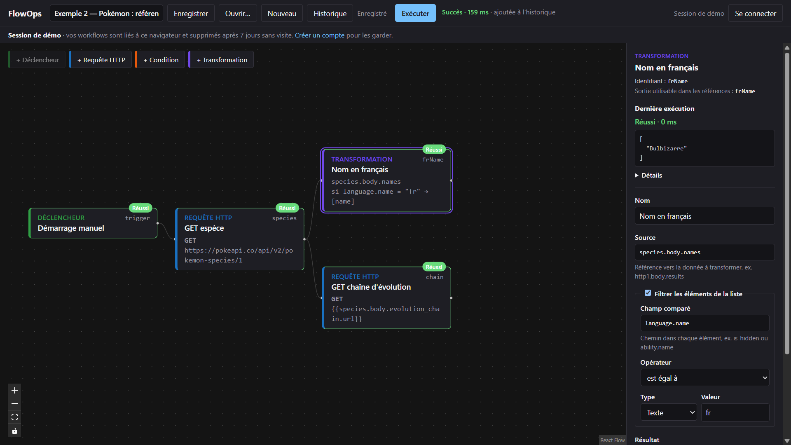
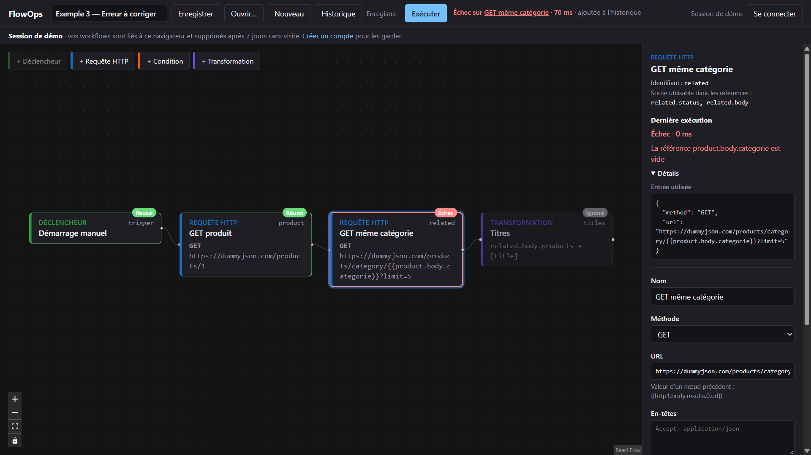
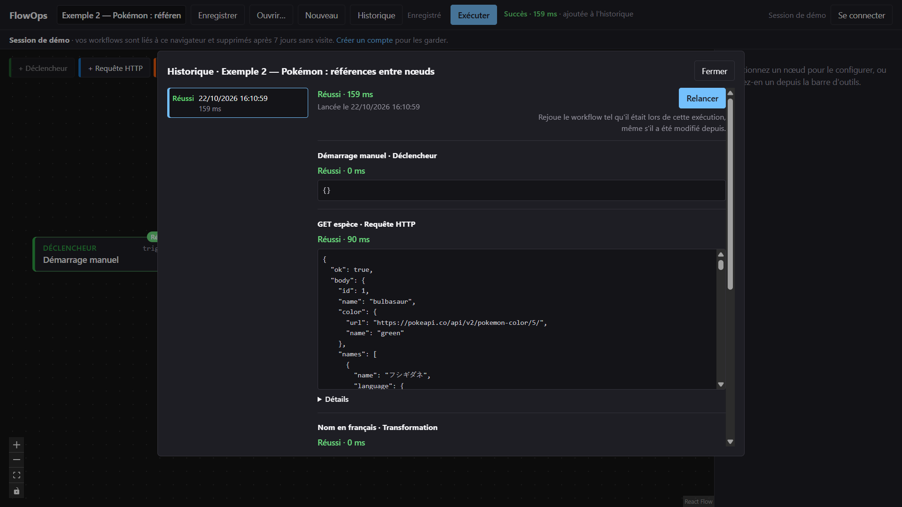

# Trois scénarios pour découvrir FlowOps

Sur **[flowops.vincent-angoulvant.fr](https://flowops.vincent-angoulvant.fr)**, sans inscription. À l'arrivée, une session de démo s'ouvre avec trois workflows d'exemple ; le premier est déjà affiché. Chaque scénario prend une à deux minutes.

## 1. Un workflow qui réussit : suivre les données d'un nœud à l'autre

**Ouvrir…** → « Exemple 2 — Pokémon : références entre nœuds ».

1. Cliquer sur **Exécuter**. Les quatre nœuds passent en « Réussi », l'en-tête affiche la durée et « ajoutée à l'historique ».
2. Cliquer sur **GET espèce** : le panneau de droite montre la réponse de PokéAPI (statut, corps JSON) et, dans **Détails**, la requête réellement envoyée.
3. Cliquer sur **Nom en français** : cette transformation filtre la liste `species.body.names` sur `language.name = "fr"` et extrait `name`. Sortie : `["Bulbizarre"]`.
4. Cliquer sur **GET chaîne d'évolution** : son URL n'est pas écrite en dur, elle vaut `{{species.body.evolution_chain.url}}`, un champ de la réponse précédente.

**Ce que ça montre** : les références entre nœuds, les branches parallèles (deux nœuds après `species`), et une exécution lisible nœud par nœud.

## 2. Un workflow qui échoue : trouver et corriger l'erreur

**Ouvrir…** → « Exemple 3 — Erreur à corriger ».

1. **Exécuter**. L'en-tête affiche « Échec sur GET même catégorie » ; le nœud est rouge, le suivant (« Titres ») est **Ignoré** : après un échec, le workflow s'arrête.
2. Cliquer sur **Échec sur GET même catégorie** dans l'en-tête, ou sur le nœud : le panneau indique « La référence product.body.categorie est vide », et **Détails** montre l'URL telle qu'elle allait partir.
3. Cliquer sur **GET produit** et regarder sa sortie : le champ s'appelle `category`, pas `categorie`.
4. Sur **GET même catégorie**, corriger l'URL : `…/category/{{product.body.category}}?limit=5`, puis **Exécuter**. Tout passe au vert, « Titres » liste les produits de la même catégorie.

Pour voir la protection du serveur : remplacer l'URL de **GET produit** par `http://169.254.169.254/` (serveur de métadonnées du cloud) ou `http://localhost:3000/health`, puis exécuter. Le nœud échoue avec « Adresse non autorisée », sans rien révéler de la cible.

**Ce que ça montre** : un message d'erreur qui dit quoi corriger, l'entrée réellement utilisée, la politique d'échec, et la [politique réseau](security/http-node.md) du nœud HTTP.

## 3. Modifier puis remonter le temps : l'historique

Repartir de l'exemple 3 corrigé (ou de n'importe quel exemple).

1. Modifier un nœud, par exemple le nom ou la `limit` de l'URL, puis **Exécuter** une nouvelle fois. Chaque exécution est enregistrée, même sans cliquer sur **Enregistrer**.
2. **Historique** : la liste montre toutes les exécutions, réussies ou non. En choisir une ancienne : son détail affiche les nœuds tels qu'ils étaient à ce moment-là, avec leurs entrées et sorties.
3. **Relancer** : l'ancienne version est rejouée telle quelle, et la nouvelle exécution s'ajoute en tête de liste. Le workflow affiché dans l'éditeur n'est pas modifié.

**Ce que ça montre** : l'historique garde une copie du graphe exécuté. Modifier un workflow ne réécrit pas son passé, et un ancien résultat se rejoue à l'identique.

## Pour aller plus loin

- **Créer un compte** depuis le bandeau : les workflows de la session de démo sont gardés.
- **Limites** : une session de démo est limitée à 10 exécutions par minute, 5 workflows et 20 secondes par exécution ; au-delà, un message explique la limite atteinte.
- Le fonctionnement et les choix techniques : [architecture](architecture.md), [décisions](decisions.md).
