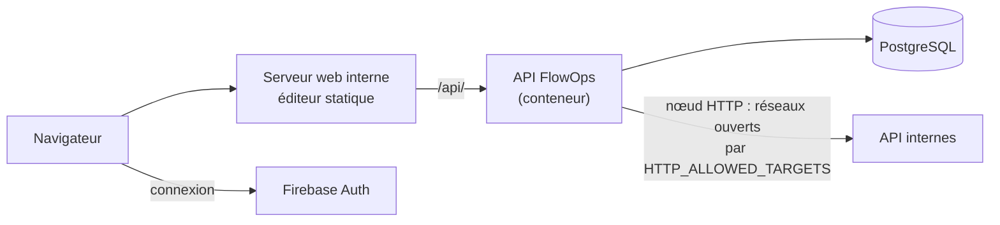

# Installation en entreprise

FlowOps peut tourner sur le réseau d'une entreprise pour appeler ses API internes. Le code est le même qu'en production publique ; seule la configuration change.

## Ce qu'il faut

| Élément         | Rôle                                                                                                                        |
| --------------- | --------------------------------------------------------------------------------------------------------------------------- |
| PostgreSQL      | Base de FlowOps (workflows, historique), testée avec la version 18. Une base vide, avec un rôle qui peut y créer des tables |
| Projet Firebase | Comptes et connexion (Google, email). Un projet propre à l'entreprise                                                       |
| Image de l'API  | Construite depuis le [`Dockerfile`](../Dockerfile) du dépôt                                                                 |
| Éditeur         | Fichiers statiques (`apps/web/dist`), servis par n'importe quel serveur web                                                 |
| Serveur web     | Sert l'éditeur et transmet `/api/` à l'API, sur la même origine                                                             |



## 1. Base de données

Créer une base et un rôle, puis appliquer les migrations depuis une copie du dépôt (Node.js 24) :

```bash
npm ci
cd apps/api
DATABASE_URL="postgresql://flowops:…@db.interne:5432/flowops" npx prisma migrate deploy
```

À refaire à chaque nouvelle version de FlowOps, avant de démarrer la nouvelle image. L'image ne migre pas elle-même : plusieurs instances démarrées ensemble ne doivent pas migrer en même temps.

## 2. API

```bash
docker build -t flowops-api .
docker run -d --name flowops-api -p 8080:8080 \
  -e DATABASE_URL="postgresql://flowops:…@db.interne:5432/flowops" \
  -e FIREBASE_PROJECT_ID="flowops-entreprise" \
  -e CORS_ORIGIN="https://flowops.interne.entreprise.fr" \
  -e HTTP_ALLOWED_TARGETS="10.20.0.0/16,*.interne.entreprise.fr" \
  -e HTTP_DENIED_TARGETS="10.20.99.0/24" \
  -e DEMO_SESSIONS_ENABLED=false \
  -e TRUST_PROXY_HOPS=1 \
  flowops-api
```

| Variable                | Valeur en entreprise                                                                                   |
| ----------------------- | ------------------------------------------------------------------------------------------------------ |
| `DATABASE_URL`          | Obligatoire. Adresse de la base                                                                        |
| `FIREBASE_PROJECT_ID`   | Obligatoire. Seuls les jetons de ce projet sont acceptés                                               |
| `HTTP_ALLOWED_TARGETS`  | Réseaux (CIDR) et domaines internes que le nœud HTTP peut appeler. Vide : adresses publiques seulement |
| `HTTP_DENIED_TARGETS`   | Exclusions prioritaires, par exemple le réseau de la base de FlowOps ou d'outils d'administration      |
| `DEMO_SESSIONS_ENABLED` | `false` : pas de sessions anonymes, seuls les comptes de l'entreprise entrent                          |
| `TRUST_PROXY_HOPS`      | Nombre de relais devant l'API qui ajoutent `X-Forwarded-For` (1 derrière un seul serveur web)          |
| `CORS_ORIGIN`           | Adresse de l'éditeur, utile seulement si un navigateur appelle l'API sur une autre origine             |
| `PORT`                  | 8080 par défaut                                                                                        |

Quelles que soient les listes, la boucle locale et le serveur de métadonnées du cloud restent interdits, et une liste mal écrite empêche l'API de démarrer. Règles et scénarios : [security/http-node.md](security/http-node.md).

Sonde de disponibilité : `GET /health` répond `{ "status": "ok" }`.

## 3. Éditeur

La configuration Firebase est lue au moment du build (elle finit dans le JavaScript servi au navigateur) :

```bash
VITE_FIREBASE_API_KEY=… \
VITE_FIREBASE_AUTH_DOMAIN=flowops.interne.entreprise.fr \
VITE_FIREBASE_PROJECT_ID=flowops-entreprise \
VITE_FIREBASE_APP_ID=… \
npm run build -w web
```

Puis servir `apps/web/dist` : toute adresse inconnue renvoie `index.html`, et `/api/` est transmis à l'API. Exemple avec nginx :

```nginx
server {
  server_name flowops.interne.entreprise.fr;
  root /srv/flowops/dist;

  location /api/ {
    proxy_pass http://flowops-api:8080;
    proxy_set_header X-Forwarded-For $proxy_add_x_forwarded_for;
    proxy_set_header X-Forwarded-Proto $scheme;
  }

  location / {
    try_files $uri /index.html;
  }
}
```

## 4. Firebase

Dans la console Firebase du projet de l'entreprise :

- **Authentication > Sign-in method** : Google et/ou email/mot de passe. Laisser **Anonyme** désactivé.
- **Domaines autorisés** : l'adresse de l'éditeur.
- **Clé d'API web** (console Google Cloud, _Identifiants_) : la restreindre à l'adresse de l'éditeur et aux API `identitytoolkit.googleapis.com` et `securetoken.googleapis.com`.

Pour une connexion avec les comptes de l'entreprise (Microsoft Entra ID, Okta…), Identity Platform accepte OIDC et SAML sans changement de l'API : voir les pistes d'évolution de la [roadmap](roadmap.md).

## Derrière un proxy qui inspecte le HTTPS

Si les appels sortants passent par un proxy d'entreprise avec son propre certificat, le nœud HTTP doit lui faire confiance : ajouter le certificat de l'entreprise au magasin du système dans l'image (image dérivée de `flowops-api`), et démarrer le conteneur avec `NODE_OPTIONS=--use-system-ca`, comme `npm run dev:api` en local. Sans cela, les requêtes échouent avec « Certificat TLS non reconnu ».
